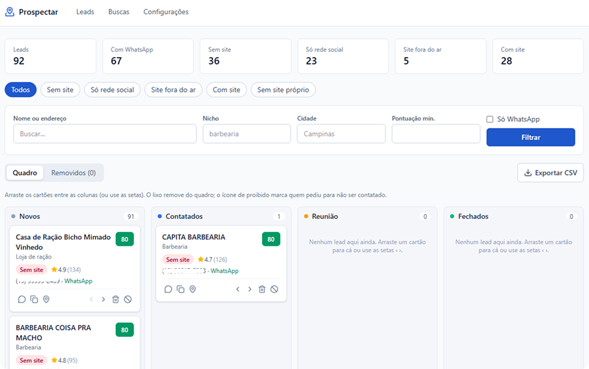

# Prospectar



Encontre clientes no Google Maps por **nicho** e **cidade**. O Prospectar mostra na hora quem **não tem site**, quem **só tem Instagram/Facebook** e quem tem **site fora do ar**, e abre o **WhatsApp** do negócio com uma mensagem pronta.

Tudo roda no seu computador, de graça, sem precisar de chave de API.

**O que ele faz:**

- Busca negócios no Google Maps (ex.: "barbearia" em "Campinas, SP").
- Separa cada negócio em: **sem site**, **só rede social**, **site fora do ar** ou **com site**.
- Encontra telefone, WhatsApp, e-mail, Instagram e Facebook.
- Dá uma **nota de 0 a 100** para você saber quem abordar primeiro.
- Organiza os contatos num quadro: **Novos → Contatados → Reunião → Fechados**.
- Exporta a lista para Excel ou Google Sheets.
- Com o Claude Code, escreve uma mensagem de abordagem personalizada para cada negócio.

---

## Instalação

Escolha um dos dois jeitos. Os dois levam uns 20 minutos na primeira vez (a maior parte é esperar downloads).

- **[Jeito 1: com o Claude Code](#jeito-1-instalar-com-o-claude-code-mais-fácil)** — você cola um texto e o Claude faz o resto. Recomendado.
- **[Jeito 2: passo a passo, sozinho](#jeito-2-instalar-sozinho-passo-a-passo)** — você digita os comandos.

### Jeito 1: instalar com o Claude Code (mais fácil)

1. Instale o **Claude Code**: baixe o app do Claude em https://claude.ai/download, abra e entre na sua conta. Vá na aba **Code**.
2. Comece uma conversa nova e cole este texto:

   ```text
   Quero instalar o projeto Prospectar no meu computador.

   1. Se o Git não estiver instalado, me ajude a instalar primeiro.
   2. Clone o repositório https://github.com/SEU-USUARIO/prospectar.git dentro da minha pasta de usuário, numa pasta chamada "prospectar".
   3. Abra o arquivo INSTALAR-COM-CLAUDE.md desse repositório e siga todos os passos.

   Eu não sou programador: me explique cada passo de forma simples e me avise sempre que eu precisar fazer alguma coisa.
   ```

3. Acompanhe e aceite os pedidos de permissão. Em alguns momentos o Claude vai pedir que **você** faça algo, como abrir o Docker Desktop ou reiniciar o computador.
4. No final, o painel abre sozinho no navegador.

Depois de instalado, para usar no dia a dia veja [Usando no dia a dia](#usando-no-dia-a-dia).

### Jeito 2: instalar sozinho, passo a passo

#### Passo 1. Instale os 3 programas

Você só faz isso uma vez.

**No Windows:**

1. **Node.js** (faz o projeto funcionar): acesse https://nodejs.org, baixe a versão **LTS** e instale clicando em "Next" até o fim.
2. **Git** (baixa o projeto): acesse https://git-scm.com/download/win, baixe e instale clicando em "Next" até o fim.
3. **Docker Desktop** (roda o motor de busca): acesse https://www.docker.com/products/docker-desktop/, baixe e instale. Deixe marcada a opção **"Use WSL 2"**. Se pedir para reiniciar o computador, reinicie.
4. Abra o **Docker Desktop** pelo menu Iniciar, aceite os termos e pule o cadastro (pode clicar em "Skip"). Espere aparecer **"Engine running"** no canto de baixo.

**No Mac:**

1. **Node.js**: https://nodejs.org, versão **LTS**.
2. **Git**: abra o Terminal e digite `git --version`. Se não estiver instalado, o Mac oferece instalar; aceite.
3. **Docker Desktop**: https://www.docker.com/products/docker-desktop/. Escolha **Apple Silicon** (M1, M2, M3, M4) ou **Intel**, conforme o seu Mac. Abra o Docker Desktop e espere aparecer **"Engine running"**.

#### Passo 2. Abra o terminal

O terminal é uma janela onde você digita comandos. Para cada comando abaixo: **copie, cole no terminal e aperte Enter**. Espere terminar antes de colar o próximo.

- **Windows:** abra o menu Iniciar, digite **Terminal** (ou **PowerShell**) e abra.
- **Mac:** aperte `Cmd + Espaço`, digite **Terminal** e abra.

Para conferir se o Passo 1 deu certo, rode:

```bash
node --version
```

```bash
git --version
```

```bash
docker --version
```

Cada um deve mostrar um número de versão. O do Node precisa começar com **22** ou mais. Se algum der erro, feche o terminal, abra de novo e tente outra vez. Se continuar dando erro, reinstale aquele programa.

#### Passo 3. Baixe o projeto

Estes comandos criam a pasta `prospectar` dentro da sua pasta de usuário e entram nela:

```bash
cd ~
```

```bash
git clone https://github.com/SEU-USUARIO/prospectar.git
```

```bash
cd prospectar
```

#### Passo 4. Instale e prepare

Confira se o Docker Desktop está aberto com "Engine running" e rode:

```bash
npm install
```

```bash
npm run setup
```

O `npm install` baixa as peças do projeto (1 a 3 minutos). O `npm run setup` cria a configuração, o banco de dados e liga o motor de busca. **Na primeira vez ele baixa cerca de 1 GB**, então pode demorar alguns minutos. No final aparece **"Tudo pronto!"**.

#### Passo 5. Abra o painel

```bash
npm run iniciar
```

O navegador abre sozinho em **http://localhost:3000**. Se não abrir, digite esse endereço no navegador.

Pronto! Agora siga para [Sua primeira busca](#sua-primeira-busca).

---

## Usando no dia a dia

Toda vez que for usar:

1. Abra o **Docker Desktop** e espere "Engine running".
2. Abra o terminal e entre na pasta do projeto:
   ```bash
   cd ~/prospectar
   ```
3. Abra o painel:
   ```bash
   npm run iniciar
   ```

Deixe o terminal aberto enquanto usa. Para desligar, clique no terminal e aperte **Ctrl + C**.

### Sua primeira busca

1. No painel, clique em **Buscas**.
2. Em **Nicho**, escreva o tipo de negócio como você digitaria no Google Maps: `barbearia`, `dentista`, `pet shop`...
3. Em **Cidade**, escreva a cidade e o estado: `Campinas, SP`.
4. Deixe a **Cobertura** em **Normal** e clique em **Buscar**.
5. Espere a barra completar (de 2 a 10 minutos). **Deixe essa página aberta**: se fechar, a busca pausa e continua quando você voltar.
6. Clique em **Leads**: os negócios encontrados aparecem na coluna **Novos** do quadro.

### Entendendo o quadro de leads

O quadro tem 4 colunas, que mostram em que pé está cada conversa:

| Novos | Contatados | Reunião | Fechados |
|---|---|---|---|
| Encontrados nas buscas, ainda sem contato | Você já mandou mensagem | Marcou conversa ou reunião | Virou cliente |

- **Para mudar de coluna:** arraste o cartão, ou use as setas **‹ ›** no pé do cartão. Ao abrir o WhatsApp de um lead em "Novos", ele vai sozinho para "Contatados".
- **A nota (0 a 100)**, no canto do cartão: quanto maior, melhor a oportunidade. Cada coluna já vem ordenada por ela.
- **As etiquetas coloridas:**
  - 🔴 **Sem site**: não tem site nenhum.
  - 🟡 **Só rede social**: usa Instagram, Facebook ou WhatsApp no lugar de um site.
  - 🟠 **Site fora do ar**: tem endereço de site, mas ele não abre ou foi perdido.
  - ⚪ **Com site**: tem site funcionando.
- **Os botões do cartão:**
  - **Balão**: abre o WhatsApp com a mensagem pronta.
  - **Copiar**: copia a mensagem.
  - **Mapa**: abre o negócio no Google Maps.
  - **Lixo**: remove o lead do quadro (não tem interesse, não é o perfil...).
  - **Proibido**: "não contatar". Use quando a pessoa pedir para não receber mais mensagens. O lead sai do quadro e não volta mesmo que apareça em buscas novas.
- **Removidos:** a aba ao lado de "Quadro" mostra tudo que saiu do quadro, com um botão para trazer de volta se você remover por engano.
- **Clique no nome** do negócio para ver os detalhes, editar a mensagem e anotar o que foi conversado.
- **Exportar CSV**: baixa os leads do quadro (com os filtros aplicados) para abrir no Excel ou no Google Sheets.

Para mudar a mensagem padrão do WhatsApp, vá em **Configurações**.

### Cobertura da cidade

O Google Maps mostra no máximo uns **120 negócios por busca**, não importa o tamanho da cidade. A cobertura divide o mapa da cidade em partes e faz uma busca em cada parte.

| Cobertura | Buscas | Encontra até | Use para |
|---|---|---|---|
| **Normal** | 1 | ~120 negócios | cidades pequenas ou um bairro |
| **Ampliada** | 4 | ~480 negócios | cidades médias e grandes |

**Dica:** comece sempre com a **Normal**. Se vier perto de 120 negócios, refaça com a **Ampliada**.

**Profundidade** é quanto o sistema rola a lista dentro de cada busca. Deixe em 10.

---

## Usando com o Claude Code

Abra o Claude Code na pasta `prospectar` e use:

- `/prospectar dentistas em Ribeirão Preto sem site`: faz a busca e resume os resultados.
- `/prospectar-mensagens barbearias sem site, eu vendo sites`: escreve uma mensagem personalizada para cada lead. As mensagens aparecem no painel e no botão do WhatsApp.
- `/prospectar-setup`: confere se está tudo instalado e funcionando.

Também dá para pedir com suas palavras: *"me mostra as 10 melhores oportunidades de pet shop em Valinhos"*.

---

## Deu problema?

| O que aparece | O que fazer |
|---|---|
| "Motor fora do ar" | Abra o Docker Desktop, espere "Engine running" e rode `npm run iniciar` de novo. |
| `npm`, `node`, `git` ou `docker` "não é reconhecido" | O programa não foi instalado ou o terminal estava aberto antes da instalação. Feche e abra o terminal. Se continuar, reinstale o programa. |
| "O projeto ainda não foi preparado" | Rode `npm run setup`. |
| A busca termina com 0 leads | Confira a escrita do nicho e da cidade (`Cidade, UF`). Se estava funcionando antes, pode ser bloqueio temporário do Google: espere de 30 minutos a algumas horas. |
| Buscas com "falhou" | Provável bloqueio temporário do Google. Espere um pouco antes de buscar de novo. |
| A busca parou | Ela pausa quando a página Buscas fecha. Abra a página de novo que ela continua. |
| Erro no `npm install` | Confira se o Node é a versão 22 ou mais nova (`node --version`). Apague a pasta `node_modules` e rode `npm install` de novo. |
| Mac com chip M1/M2/M3/M4 e o motor não sobe | No arquivo `docker-compose.yml`, apague o `#` da linha `# platform: linux/amd64` e rode `npm run setup`. |

Ainda travado? Abra o Claude Code na pasta do projeto e descreva o problema; ele conhece o projeto.

## Atualizar para a versão mais nova

Na pasta do projeto:

```bash
git pull
```

```bash
npm install
```

```bash
npm run setup
```

Seus leads e configurações são mantidos.

---

## Use com responsabilidade

- **Bloqueio do Google:** o motor acessa o Google Maps como um navegador comum, sem login, então **sua conta Google não corre risco**. Mas muitas buscas seguidas podem fazer o Google bloquear seu IP por algumas horas. Faça poucas buscas por vez.
- **Termos do Google:** fazer scraping do Google Maps vai contra os Termos de Serviço do Google. Use para a sua própria prospecção, em volume modesto, e não revenda os dados.
- **LGPD:** telefone e e-mail são dados pessoais. Aborde de forma pontual e relevante, diga quem você é, e **não volte a contatar quem pediu para sair** (botão "não contatar").
- **WhatsApp:** nada de disparo em massa. O WhatsApp bane números que mandam spam. Uma mensagem personalizada por vez.
- Seus leads ficam só no seu computador (pasta `data/`) e não vão para o GitHub.

## Mais informações

- [Guia avançado](docs/avancado.md): linha de comando, API oficial do Google (Places), proxies, estrutura do código.
- [Nichos e abordagens](docs/nichos.md): ideias de nichos que costumam ter muitos negócios sem site.

## Créditos

O motor de busca é o [gosom/google-maps-scraper](https://github.com/gosom/google-maps-scraper), de Georgios Komninos (licença MIT). Ideias de organização vieram do [google-maps-scraper-kit](https://github.com/Mahanaicoach/google-maps-scraper-kit). Detalhes em [CREDITS.md](CREDITS.md).

Licença MIT: [LICENSE](LICENSE).
